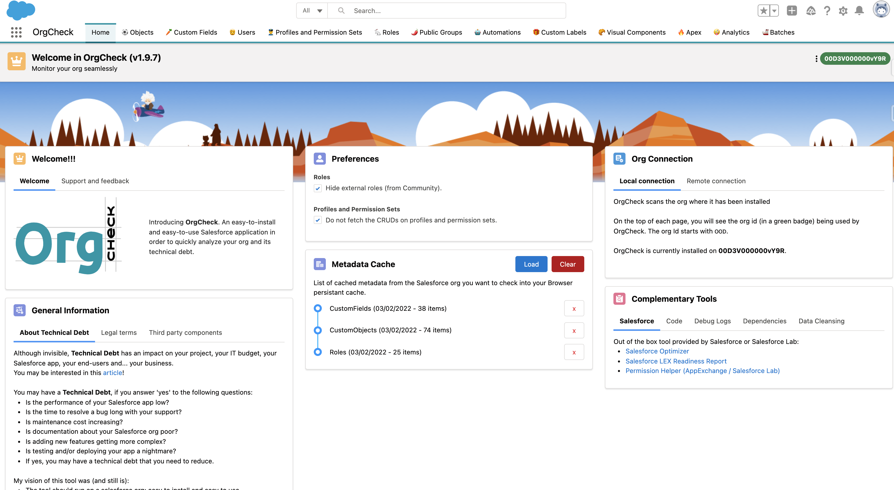

# Welcome to Org Check

Let administrators, developers, customers and partners have an application within 
their Salesforce org to monitor and help **continuously reduce their technical debt**.

**Org Check** comes into two flavours:
- a Salesforce application, including a nice UI -- suitable for regular users
- a sf CLI plugin, unix command like tool -- ideal for automation and multi-org scenario

Either way, Org Check is meant to be **easy to install and easy to use**:
- It requires no additional software or platform whatsoever. 
- If you want to use the app: you just need to install the package from the AppExchange in your org
- If you want to use the sf plugin: you just need to install the plugin from your sf CLI locally
- No custom object will be added, no external connection, all stays in your computer (browser or terminal) and your org.
- Org Check is free of use: open sourced, available on the AppExchange (thanks to the great program called **Salesforce Labs** at Salesforce) and on the NPMjs website.

Please use [this deck](http://sfdc.co/OrgCheck-Presentation) with your colleagues, company or customers to present the application before installing it and using it for your org.

Keep in mind that Org Check is not a Salesforce product. It has not been officially tested or documented by Salesforce. Also Salesforce support is not available for Org Check. Support is based on open source participation and requests are managed (as we can) via GitHub at (https://github.com/SalesforceLabs/OrgCheck/issues).

  

    <h2>Want to preview the app!</h2>
    
Go to: <a href="./preview">Preview</a>

    

  

  

    <h2>Security team has questions?</h2>
    
Please review our list of questions and answers related to security in our <a href="./security">Security FAQ</a>!

  

  
 
    <h2>Install the salesforce app</h2>
    
Go to AppExchange, search "Org Check" then Install or Try it!

    
For any installation questions, please visit our <a href="./faq">FAQ</a>!

  

  

    <h2>Install the sf plugin</h2>
    
From a terminal, type <code>sf plugins install @orgcheck/sfdx-plugin</code>

    
For any installation questions, please visit our <a href="./faq">FAQ</a>!

  

  

    <h2>Help & Support</h2>
    <ul>
      <li><a href="https://sfdc.co/OrgCheck-Community">Trailblazer</a></li>
      <li><a href="https://www.linkedin.com/company/orgchecksfdc">LinkedIn</a></li>
      <li><a href="https://www.sfdc.co/OrgCheck-Repository">Source</a></li>
      <li><a href="https://www.sfdc.co/OrgCheck-Backlog">Issues & Ideas</a></li>
    </ul>
  

  

    <h2>We want you!</h2>
    
Go to <a href="./development">Development Setup Guide</a> for the information you need.

  

  

## Useful references
- [Salesforce Help article mentioning Org Check as an alternative to Salesforce Optimizer](https://help.salesforce.com/s/articleView?id=004980242&type=1)
- [Youtube Video: "Optimizer Is Sunsetting: Learn How To Use Org Check!" by Kate Lessard](https://www.youtube.com/watch?v=DwHchT_uFGQ)
- [Article on  Salesforce's Ben: "Free technical debt analysis"](https://www.salesforceben.com/salesforce-org-check-free-technical-debt-analysis)
- [Article on Pablo Gonzalez blog: "10 Salesforce Open-source Projects for DevOps Engineers"](https://www.pablogonzalez.io/top-10-salesforce-open-source-projects-for-devops/#4-orgcheck)
- [Youtube Video: "Reduce Technical Debt with Org Check"](https://www.youtube.com/watch?v=gjv6q-AR1m0)
- [Article on Medium: "How to contin uously monitor, balance, challenge, and reduce Technical Debt in a Salesforce org?"](https://medium.com/@vfinet/how-to-continuously-monitor-balance-challenge-and-reduce-technical-debt-in-a-salesforce-org-8809cef4ce4a)
- [Article on Medium:  "Five concrete actions to reduce technical debt related to Apex Classes"](https://medium.com/@vfinet/five-concret-actions-to-reduce-technical-debt-related-to-apex-classes-reduce-technical-debt-f71a31e4b30c)
- [Youtube Video: "Org Check Review by Ike Wagh"](https://www.youtube.com/watch?v=IG4zzqVsO_8)
- [Salesforce Labs Live! "How to Reduce Technical Debt from your Salesforce Environment (Ep.1)"](https://www.youtube.com/watch?v=ZCJ_NH-29I0)
- [Albanian Dreamin21: "Org Check presentation" by Sara Sali and Vincent Finet](https://dreamin21.sfalbania.al/schedule/schedule-fullwidth-filterable/)
- [Article on Unofficial SF: "Analyze your org with Org Check"](https://unofficialsf.com/from-vincent-finet-analyze-your-org-with-orgcheck/)
- [Article on Salesforce's Ben: "Free ways to monitor your Salesforce org"](https://www.salesforceben.com/free-ways-to-monitor-your-salesforce-org/)

